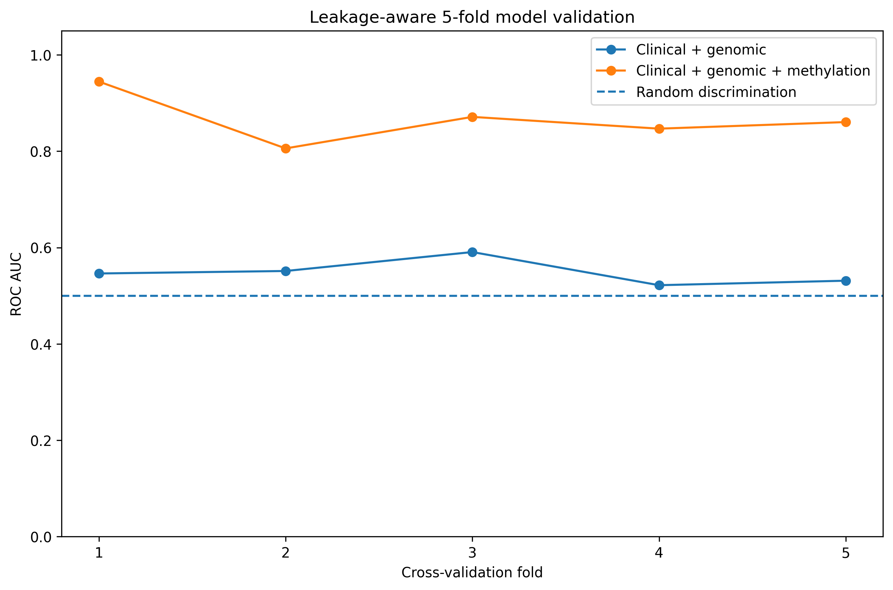
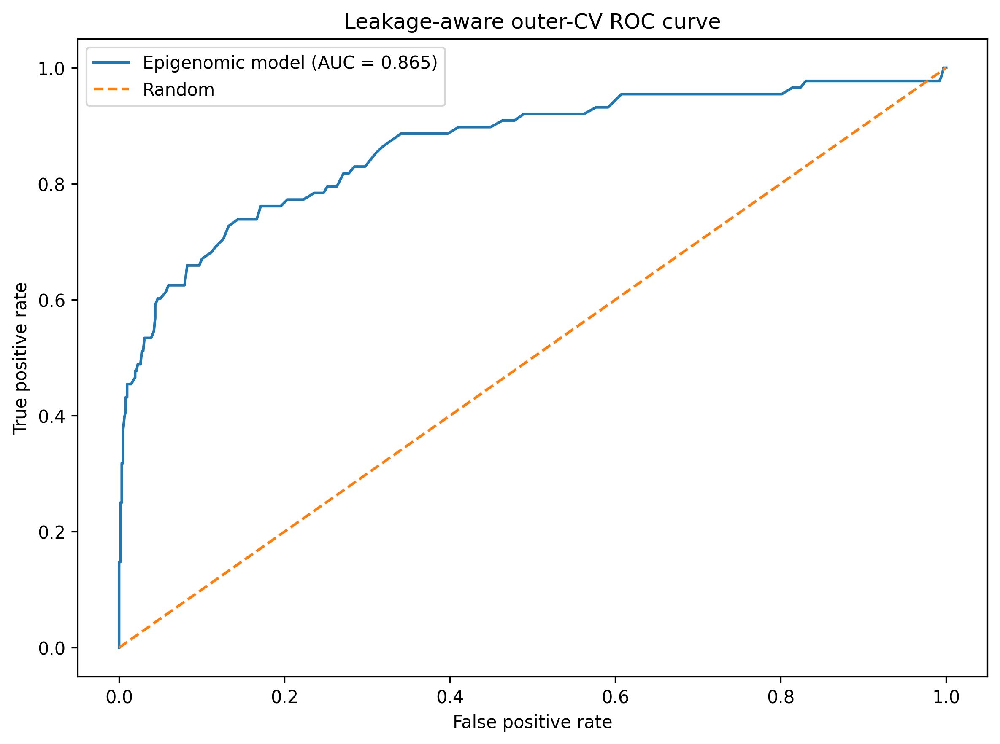
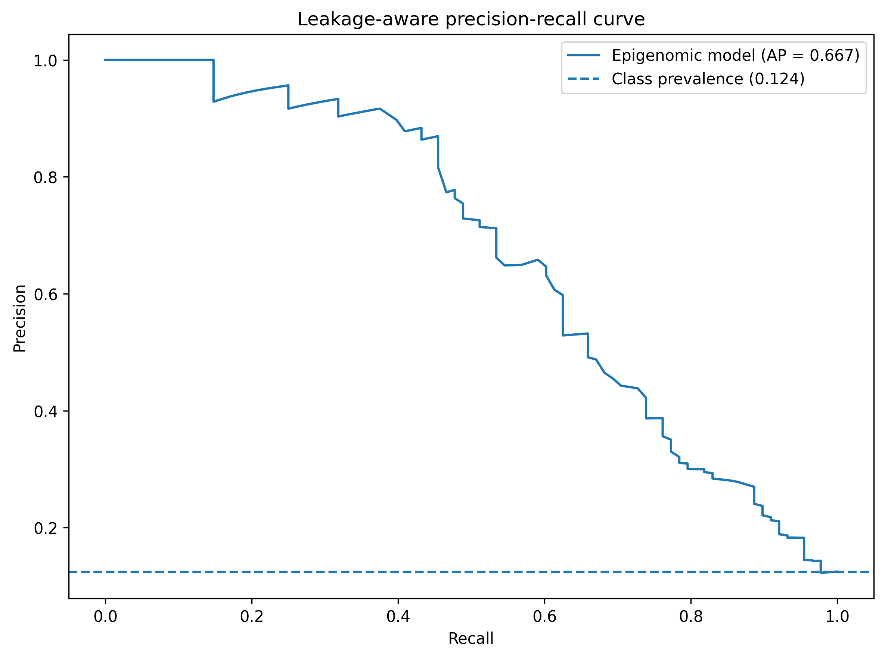
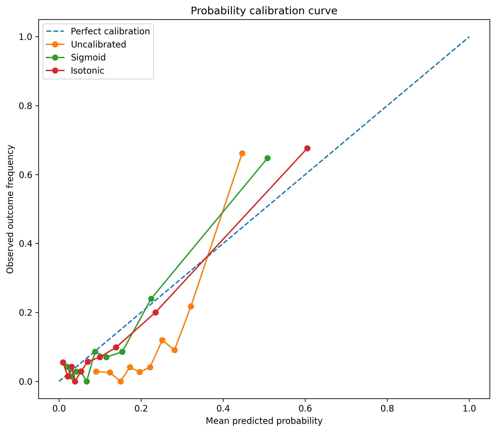
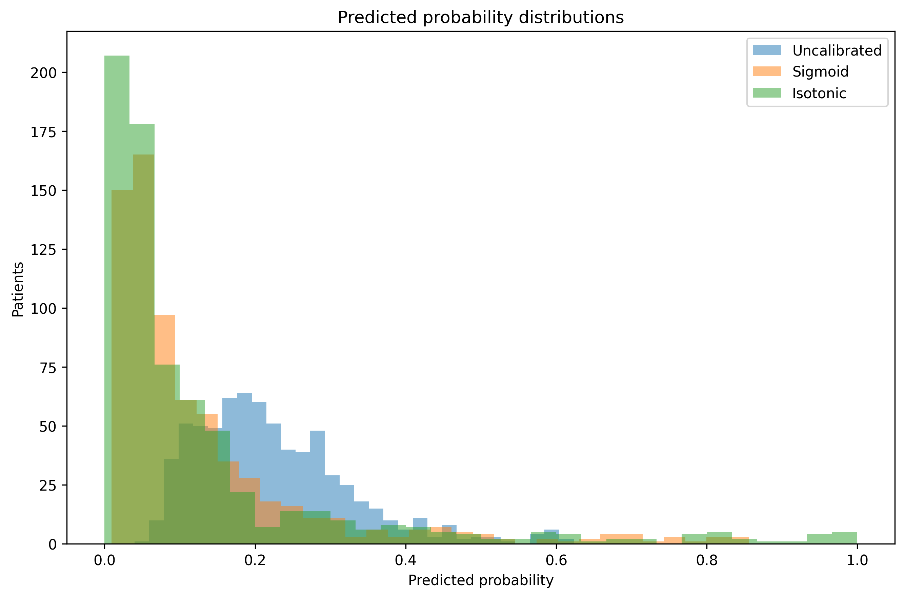
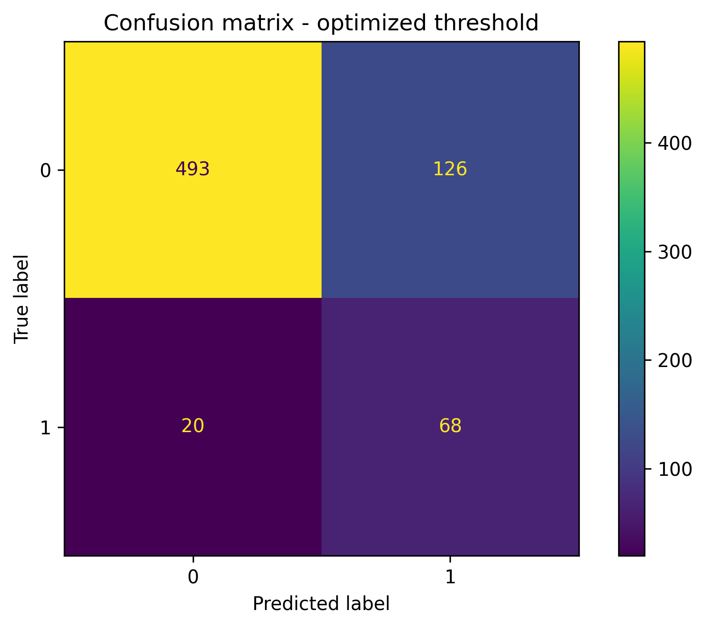

# Month 2 Final Report

## Epigenomics Integration and AI-Ready Multi-Omics Pipeline Extension

## Overview

Month 2 extended the clinical-genomic workflow with DNA methylation data.

The final workflow includes methylation quality control, patient matching, multi-omics integration, feature selection, machine-learning classification, survival modelling, leakage-aware validation, decision-threshold optimisation, probability calibration and final model packaging.

## Completed workflow

1. Methylation data preparation
2. Methylation quality control
3. Sample-to-patient matching
4. Clinical-genomic-epigenomic integration
5. Epigenomic visualisation
6. Methylation feature selection
7. AI-ready feature-table generation
8. Classification modelling
9. Cox survival modelling
10. Feature-importance analysis
11. Leakage-aware model validation
12. Classification-threshold optimisation
13. Probability calibration
14. Final calibrated model training

## Leakage-aware model validation

Step 21 re-evaluated classification performance using stratified cross-validation and leakage controls.

| model                       |   folds |   accuracy_mean |   accuracy_std |   balanced_accuracy_mean |   balanced_accuracy_std |   precision_mean |   precision_std |   recall_mean |   recall_std |   f1_score_mean |   f1_score_std |   roc_auc_mean |   roc_auc_std |   roc_auc_change_vs_baseline |
|:----------------------------|--------:|----------------:|---------------:|-------------------------:|------------------------:|-----------------:|----------------:|--------------:|-------------:|----------------:|---------------:|---------------:|--------------:|-----------------------------:|
| clinical_genomic            |       5 |        0.796344 |     0.038815   |                 0.479447 |               0.0384422 |        0.0953846 |       0.0926214 |     0.0575163 |    0.041633  |       0.0708175 |      0.0572627 |       0.548208 |     0.026449  |                     0        |
| clinical_genomic_epigenomic |       5 |        0.895315 |     0.00946693 |                 0.583507 |               0.0396044 |        0.9       |       0.223607  |     0.168627  |    0.0762776 |       0.28134   |      0.118676  |       0.865727 |     0.0505158 |                     0.317519 |

### Interpretation

The cross-validation analysis provides a more reliable estimate of generalisation performance than the original single train/test result.

Patient identifiers, sample identifiers, survival variables and obvious outcome proxies were excluded from the predictor set.

## Decision-threshold optimisation

Because the outcome classes are imbalanced, classification performance was evaluated at both the conventional threshold of 0.50 and a threshold selected from training-fold predictions.

| strategy     |   folds |   accuracy_mean |   accuracy_std |   balanced_accuracy_mean |   balanced_accuracy_std |   precision_mean |   precision_std |   recall_mean |   recall_std |   f1_score_mean |   f1_score_std |   roc_auc_mean |   roc_auc_std |   pr_auc_mean |   pr_auc_std |   threshold_mean |   threshold_std |
|:-------------|--------:|----------------:|---------------:|-------------------------:|------------------------:|-----------------:|----------------:|--------------:|-------------:|----------------:|---------------:|---------------:|--------------:|--------------:|-------------:|-----------------:|----------------:|
| default_0.50 |       5 |        0.895315 |     0.00946693 |                 0.583507 |               0.0396044 |         0.9      |        0.223607 |      0.168627 |    0.0762776 |        0.28134  |       0.118676 |       0.865727 |     0.0505158 |      0.669046 |    0.0710095 |            0.5   |       0         |
| optimized    |       5 |        0.793547 |     0.104424   |                 0.785263 |               0.0655159 |         0.400268 |        0.161264 |      0.773856 |    0.0752131 |        0.509374 |       0.132205 |       0.865727 |     0.0505158 |      0.669046 |    0.0710095 |            0.278 |       0.0238747 |

Threshold optimisation substantially changed the trade-off between precision and recall. ROC AUC and PR AUC remained threshold-independent.

## Probability calibration

Uncalibrated Random Forest probabilities were compared with sigmoid and isotonic calibration.

| method       |   folds |   roc_auc_mean |   roc_auc_std |   pr_auc_mean |   pr_auc_std |   brier_score_mean |   brier_score_std |   log_loss_mean |   log_loss_std |
|:-------------|--------:|---------------:|--------------:|--------------:|-------------:|-------------------:|------------------:|----------------:|---------------:|
| uncalibrated |       5 |       0.865727 |     0.0505158 |      0.669046 |    0.0710095 |          0.0921775 |        0.0045058  |        0.334686 |      0.0115455 |
| sigmoid      |       5 |       0.863203 |     0.0477896 |      0.66943  |    0.0395161 |          0.0718307 |        0.00228809 |        0.258716 |      0.013709  |
| isotonic     |       5 |       0.854653 |     0.0530116 |      0.670863 |    0.0404726 |          0.0683187 |        0.00362463 |        0.250961 |      0.0214615 |

Isotonic calibration achieved the lowest mean Brier score during cross-validation and was therefore selected for the final development model.

## Final calibrated model

The final development-stage classifier is a Random Forest model with isotonic probability calibration.

The final operating threshold was estimated using leakage-aware out-of-fold calibrated probabilities.

### Final internal performance

- ROC AUC: **0.853**
- PR AUC: **0.660**
- Brier score: **0.0674**
- Balanced accuracy: **0.779**
- Precision: **0.338**
- Recall: **0.773**
- F1-score: **0.471**
- Final calibrated threshold: **0.115**

### Final feature set

| feature                                    | feature_type     |
|:-------------------------------------------|:-----------------|
| subtype                                    | clinical_genomic |
| cancer_type_acronym                        | clinical_genomic |
| age                                        | clinical_genomic |
| sex                                        | clinical_genomic |
| ajcc_pathologic_tumor_stage                | clinical_genomic |
| ajcc_staging_edition                       | clinical_genomic |
| days_last_followup                         | clinical_genomic |
| days_to_birth                              | clinical_genomic |
| days_to_initial_pathologic_diagnosis       | clinical_genomic |
| ethnicity                                  | clinical_genomic |
| history_neoadjuvant_trtyn                  | clinical_genomic |
| icd_10                                     | clinical_genomic |
| icd_o_3_histology                          | clinical_genomic |
| icd_o_3_site                               | clinical_genomic |
| informed_consent_verified                  | clinical_genomic |
| new_tumor_event_after_initial_treatment    | clinical_genomic |
| path_m_stage                               | clinical_genomic |
| path_n_stage                               | clinical_genomic |
| path_t_stage                               | clinical_genomic |
| person_neoplasm_cancer_status              | clinical_genomic |
| primary_lymph_node_presentation_assessment | clinical_genomic |
| prior_dx                                   | clinical_genomic |
| race                                       | clinical_genomic |
| radiation_therapy                          | clinical_genomic |
| weight                                     | clinical_genomic |

## Final model files

- `outputs/models/final_epigenomic_calibrated_model.pkl`
- `outputs/models/final_epigenomic_model_config.json`

## Final validation tables

- `outputs/tables/model_validation_summary.csv`
- `outputs/tables/model_validation_folds.csv`
- `outputs/tables/model_leakage_audit.csv`
- `outputs/tables/threshold_optimization_summary.csv`
- `outputs/tables/optimized_thresholds.csv`
- `outputs/tables/calibration_validation_summary.csv`
- `outputs/tables/calibration_validation_folds.csv`
- `outputs/tables/final_epigenomic_model_metrics.csv`
- `outputs/tables/final_calibrated_threshold.csv`
- `outputs/tables/final_calibrated_oof_predictions.csv`

## Final figures

## Methodological interpretation

The final internal results support the conclusion that DNA methylation contributes additional predictive information beyond the original clinical-genomic feature set.

However, all reported performance values remain internal development estimates.

The final calibrated probabilities and operating threshold must not be interpreted as externally validated clinical risk estimates.

Independent external validation on a separate cohort is required before clinical use.

## Conclusion

Month 2 produced a complete clinical-genomic-epigenomic machine-learning workflow with explicit controls for data leakage, class imbalance, threshold selection and probability calibration.

The resulting calibrated model and associated validation artefacts provide a reproducible development-stage foundation for future external validation and additional multi-omics integration.
